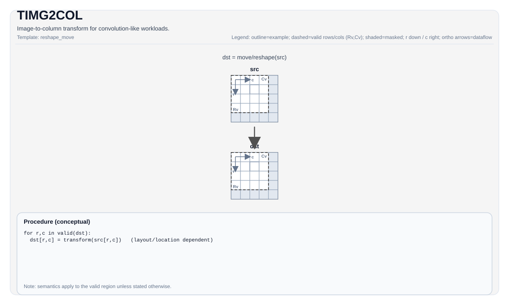

# TIMG2COL


## Tile Operation Diagram



## Introduction

Transform an input feature-map tile (e.g. NC1HWC0 layout) into an im2col-style matrix tile for convolution-like workloads. Parameters are provided via `Img2colTileConfig` and `(posM, posK)` offsets.

## C++ Intrinsic

Declared in `include/pto/common/pto_instr.hpp`:

```cpp
template <typename TileData, typename ConvTileData, SetFmatrixMode FmatrixMode = SetFmatrixMode::FMATRIX_A_MANUAL, typename... WaitEvents>
PTO_INST RecordEvent TIMG2COL(TileData &dst, ConvTileData &src, uint16_t posM = 0, uint16_t posK = 0,
                              WaitEvents &... events);
```

## Constraints

- This instruction is target/implementation-specific. See `include/pto/npu/*/TImg2col.hpp` for the supported tile types/layouts and config fields.
- **Implementation checks (A2A3)**: `TileData::DType` must be one of: `int8_t`, `half`, `bfloat16_t`, `float`.
- **Implementation checks (A5)**: `TileData::DType` must be one of: `int8_t`, `uint8_t`, `int16_t`, `uint16_t`, `int32_t`, `uint32_t`, `half`, `bfloat16_t`, `float`.

## Math Interpretation

Unless otherwise specified, semantics are defined over the valid region and target-dependent behavior is marked as implementation-defined.

## Ascend 310P (A1) profile

A1 implements public `TLOAD(ConvTile, GlobalTensor)`, `TIMG2COL` and
`SETFMATRIX` using native GM-to-L1 DMA and LoadData3DV2. No UB im2col buffer is
created. The first profile accepts:

- One complete static FP16 `NC1HWC0` image (`N=1`, `C0=16`) with identical
  valid and allocation shapes. The image must fit its allocation and 1 MiB L1;
  the caller must also reserve space for other live L1 tiles. `TLOAD` requires
  a matching contiguous global tensor or a C16-aligned NHWC channel slice.
  For a slice, the logical descriptor remains NC1HWC0, with strides
  `[H*W*row_stride, 16, W*row_stride, row_stride, 1]`. The physical row
  stride must be a multiple of 16 and cover all C1 blocks; the caller passes
  the slice's aligned base address and bounds its storage. The DMA gathers
  each C0 plane directly into L1 in chunks of at most 4095 pixels.
- An FP16 Left tile with row-major outer **and** inner fractals (ZZ, 512-byte
  fractals), full K in multiples of 16, and a positive static valid M in
  multiples of 16. Allocation must fit 64 KiB L0A. A5's NZ Left layout is
  unsupported on A1.
- Filter dimensions 1–255, stride 1–63, positive dilation, byte-sized padding,
  and channel metadata equal to `C1*16`. Feature-map metadata must match the
  image shape. `(posM, posK)` selects an in-bounds output window, with K
  aligned to 16. K order is `[C1, filterH, filterW, C0]`.
- FMATRIX A only, without transpose, destination offsets/stride, or custom
  repeat settings. Invalid runtime geometry traps before issuing im2col.

`FMATRIX_A_AUTO` sets FMATRIX and the FP16 padding register for the call.
The default `FMATRIX_A_MANUAL` reuses the caller's register settings; initialize
these with `SETFMATRIX<Image, SetFmatrixMode::FMATRIX_A_AUTO>(image)` after
configuring the image. A1 uses the native fourteen-argument instruction and
has no `SET_L3D_RPT` feature. Synchronization between DMA, im2col and MAD remains
the caller's responsibility.

`tests/compile/a1_img2col.cpp` and `test_a1_img2col_native.py` demonstrate both
register modes, CPU-oracle validation, multi-fractal layout checks, and device
readback through exact identity GEMM.

### A1 filter selection and order

A1 and CPU-SIM provide an additional C++ overload of the same instruction:

```cpp
#include <pto/pto-inst.hpp>
#include <utility>

using FilterOrder = std::integer_sequence<int, 0, 4, 8, 3, 7, 2, 6, 1, 5>;
// Configure image as above; Left is an FP16 ZZ tile with K=9*16.
TIMG2COL<Left, Image, SetFmatrixMode::FMATRIX_A_AUTO>(
    left, image, posM, posK, FilterOrder{});
```

Let `F = filterH * filterW` and `S` be the number of selected taps. The
compile-time order contains `1 <= S <= 127` unique indices, each in `[0,F)`;
it can be a full permutation or a subset. Left has exactly `S*16` columns.
`posK` must be a multiple of the original `F*16` and selects a source C16
channel group independently of `S`. For output column `j*16+c0`, tap
`FilterOrder[j]` selects the kernel row/column and `c0` selects its channel. Spatial positions, stride, dilation and padding retain
their ordinary im2col meaning. Every valid output element is defined; the
operation does not depend on prior Left contents or an in-place destination.

The source and Left retain the A1 image, layout, alignment and capacity
constraints above. Feature-map H/W are at most 32767 and the complete output
grid must keep starting source coordinates within the signed 16-bit V1 range.
V2 repeat/destination metadata remains at its default values. AUTO/MANUAL
FMATRIX A modes and event arguments are supported.

The implementation uses native LoadData3DV1, emitting one M-repeat per filter
tap. Adjacent M16 fragments jump `S` fractals in ZZ storage; no patch is staged
through UB or GM. For 3x3, `(phase+4*j)%9` describes the phase-major order used
by ordered convolution. Selecting its first six taps gives K96; selecting
`{6,7,8}` gives the K48 tail used by the RGB stem, without expanding either
to K144. Consumers must arrange weights and FP32 partial sums consistently;
selection/order alone does not establish convolution precision.

This overload is currently A1/CPU-only. A2/A3/A5 and the current PTO-AS grammar
do not expose the filter-order argument. Compiler integration is separate;
no new textual syntax is implied here. The existing V2 overload is unchanged.
`tests/compile/test_a1_img2col_order_host.py` checks independent bitwise CPU
patch/GEMM results, guards, invalid profiles and optimized CCEC V1 operands
against a direct intrinsic control. Offline compilation does not establish
device accuracy, overlap or performance.

## Examples

See related examples in `docs/isa/` and `docs/coding/tutorials/`.
