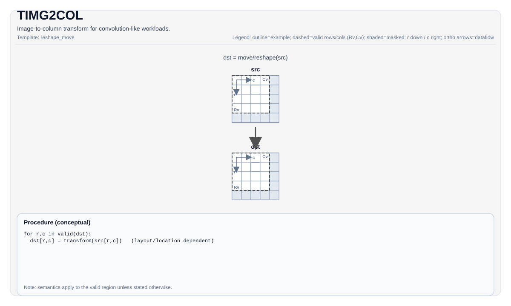

# TIMG2COL

## 指令示意图



## 简介

用于类卷积工作负载的图像到列变换。

## 数学语义

除非另有说明，语义在有效区域上定义，目标相关的行为标记为实现定义。

## C++内建接口

声明于 `include/pto/common/pto_instr.hpp`：
> 公共包含头为 `<pto/pto-inst.hpp>`，内部声明位于 `pto/common/pto_instr.hpp`。

```cpp
template <typename TileData, typename ConvTileData, SetFmatrixMode FmatrixMode = SetFmatrixMode::FMATRIX_A_MANUAL, typename... WaitEvents>
PTO_INST RecordEvent TIMG2COL(TileData &dst, ConvTileData &src, uint16_t posM = 0, uint16_t posK = 0, WaitEvents &... events);
```

## 约束

- 此指令是目标/实现特定的。有关支持的tile类型/布局和配置字段，请参见 `include/pto/npu/*/TImg2col.hpp`。
- **实现检查 (Atlas A2/A3 训练系列产品/Atlas A2/A3 推理系列产品)**：`TileData::DType` 必须是以下之一：`int8_t`、`half`、`bfloat16_t`、`float`。
- **实现检查 (Ascend 950PR/Ascend 950DT)**：`TileData::DType` 必须是以下之一：`int8_t`、`uint8_t`、`int16_t`、`uint16_t`、`int32_t`、`uint32_t`、`half`、`bfloat16_t`、`float`。

## Ascend 310P（A1）支持范围

A1 通过原生 GM→L1 DMA 和 LoadData3DV2 实现公共
`TLOAD(ConvTile, GlobalTensor)`、`TIMG2COL` 和 `SETFMATRIX`，无需在 UB
生成 im2col 中间矩阵。当前支持：

- 单张完整静态 FP16 `NC1HWC0` 图像（`N=1`、`C0=16`），有效形状与分配形状
  一致。图像需放入自身分配及 1 MiB L1；调用方还需为其他存活的 L1 tile 预留
  空间。`TLOAD` 支持形状一致的连续全局张量，或 C16 对齐的 NHWC 通道切片。
  切片的逻辑描述仍为 NC1HWC0，其步长为
  `[H*W*row_stride, 16, W*row_stride, row_stride, 1]`。物理行步长须为 16
  的倍数并容纳所有 C1 块；调用方负责提供对齐的切片基址和足够的存储。
  DMA 将每个 C0 平面直接搬入 L1，每次至多处理 4095 个像素。
- FP16 Left tile 的外层和内层 fractal 均为行主序（ZZ，512 字节 fractal），
  完整 K 和正数静态有效 M 均对齐 16，分配不超过 64 KiB L0A。
  A5 使用的 NZ Left 布局不适用于 A1。
- 卷积核各维为 1–255，步长为 1–63，膨胀率为正数，padding 为字节范围，通道
  元数据等于 `C1*16`，特征图元数据与图像形状一致。`(posM, posK)` 指定边界内
  的输出窗口，K 偏移对齐 16；K 顺序为 `[C1, filterH, filterW, C0]`。
- 仅支持 FMATRIX A，不支持转置、目标偏移/步长及自定义 repeat 设置。
  非法运行时几何参数会在发出 im2col 前 trap。

`FMATRIX_A_AUTO` 在调用时设置 FMATRIX 和 FP16 padding 寄存器。默认的
`FMATRIX_A_MANUAL` 复用调用方寄存器设置；配置图像后，可调用
`SETFMATRIX<Image, SetFmatrixMode::FMATRIX_A_AUTO>(image)` 初始化寄存器。
A1 使用原生十四参数指令，不支持 `SET_L3D_RPT`。DMA、im2col 与 MAD 之间的
同步仍由调用方负责。

`tests/compile/a1_img2col.cpp` 和 `test_a1_img2col_native.py` 展示两种寄存器
模式、CPU oracle、多 fractal 布局检查，以及通过精确单位矩阵 GEMM 的设备回读。

## 示例

参见 `docs/isa/` 和 `docs/coding/tutorials/` 中的相关示例。
