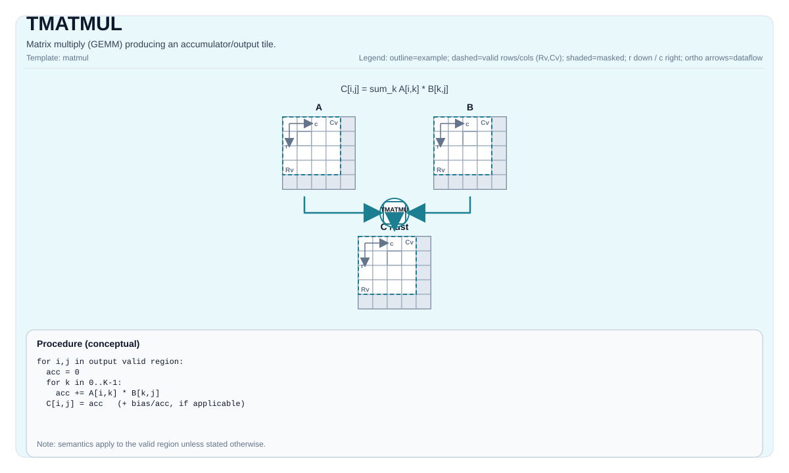

# TMATMUL

## 指令示意图



## 简介

矩阵乘法 (GEMM)，生成累加器/输出Tile。

## 数学语义

设：

- `M = aMatrix.GetValidRow()`
- `K = aMatrix.GetValidCol()`
- `N = bMatrix.GetValidCol()`

对于 `0 <= i < M` 和 `0 <= j < N`（有效矩阵乘法域中的输出元素）：

$$ \mathrm{C}_{i,j} = \sum_{k=0}^{K-1} \mathrm{A}_{i,k} \cdot \mathrm{B}_{k,j} $$

精确的累加器行为和数据类型提升由目标/实现定义。

## C++内建接口

声明于 `include/pto/common/pto_instr.hpp`：
> 公共包含头为 `<pto/pto-inst.hpp>`，内部声明位于 `pto/common/pto_instr.hpp`。

```cpp
template <typename TileRes, typename TileLeft, typename TileRight, typename... WaitEvents>
PTO_INST RecordEvent TMATMUL(TileRes &cMatrix, TileLeft &aMatrix, TileRight &bMatrix, WaitEvents &... events);

template <AccPhase Phase, typename TileRes, typename TileLeft, typename TileRight, typename... WaitEvents>
PTO_INST RecordEvent TMATMUL(TileRes &cMatrix, TileLeft &aMatrix, TileRight &bMatrix, WaitEvents &... events);
```

## 约束

- **Acc 步幅约束（CPU、Atlas A2/A3 训练系列产品/Atlas A2/A3 推理系列产品、Ascend 950PR/Ascend 950DT、Ascend 960 和 Kirin9030）**：
  `mad` 写回累加器块列时的间距是 `ceil16(m)` 行，其中 `m` 是该指令收到的行数；
  而读取该区域的一方按 Tile 的 `Rows` 推导间距。两者必须一致：
    - `((m + 15) / 16) * 16 == TileRes::Rows`，其中 `TMATMUL` 的 `m` 为 `TileLeft::ValidRow`，
      `TGEMV` 的 `m` 为 1。非 `TGEMV` 路径下 `m == 1` 会被提升为 16。
    - 当 `TileRes::Cols <= FRACTAL_NZ_ROW`（只有一个块列，间距无意义）、
      `TileRes::Compact != CompactMode::Null`，或任一值为 `DYNAMIC` 时不做校验。
      `FRACTAL_NZ_ROW` 为 16。
    - 条件中不涉及 `TileRes::ValidRow`。只要间距对得上，`ValidRow` 小于 `Rows` 的 Tile
      是合法的，此时 `Rows` 只是补齐后的分配尺寸。
- **实现检查 （Atlas A2/A3 训练系列产品/Atlas A2/A3 推理系列产品）**:
    - 支持的 `(CType, AType, BType)` 三元组：
    - `(int32_t, int8_t, int8_t)`
    - `(float, half, half)`
    - `(float, float, float)`
    - `(float, bfloat16_t, bfloat16_t)`
    - 静态形状约束：`TileLeft::Rows == TileRes::Rows`、`TileLeft::Cols == TileRight::Rows`、`TileRight::Cols == TileRes::Cols`。
    - Tile位置：`TileLeft::Loc == Left`、`TileRight::Loc == Right`、`TileRes::Loc == Acc`。
    - 运行时：`m/k/n`（取自 `aMatrix.GetValidRow()`、`aMatrix.GetValidCol()`、`bMatrix.GetValidCol()`）必须在 `[1, 4095]` 范围内。
- **实现检查 (Ascend 950PR/Ascend 950DT)**:
    - 累加器类型必须是 `int32_t` 或 `float`。
    - 如果是 `int32_t`：`AType == int8_t` 且 `BType == int8_t`。
    - 如果是 `float`：支持 `half/bfloat16_t/float`、选定的fp8对以及 `hifloat8_t/hifloat8_t`（目标定义）。
    - 静态形状约束：`TileLeft::Rows == TileRes::Rows`、`TileLeft::Cols == TileRight::Rows`、`TileRight::Cols == TileRes::Cols`。
    - 强制执行分形/布局约束：
    - Left：`Loc == Left`、`!isRowMajor`、`SFractal == RowMajor`
    - Right：`Loc == Right`、`isRowMajor`、`SFractal == ColMajor`
    - Acc：`Loc == Acc`、`!isRowMajor`、`SFractal == RowMajor`
    - 运行时：`m/k/n`（取自 `aMatrix.GetValidRow()`、`aMatrix.GetValidCol()`、`bMatrix.GetValidCol()`）必须在 `[1, 4095]` 范围内。

- **实现检查（CPU_SIM，FP8/HIF8）**：
    - 累加器类型必须为 `float`。两路输入可分别为 `float8_e4m3_t` 或 `float8_e5m2_t`，
      支持全部四种组合；`hifloat8_t` 仅支持与 `hifloat8_t` 配对。
    - 要求使用 A5 模拟模式；应在绑定 Tile 前选择目标架构，见
      [选择模拟目标架构](../coding/cpu_sim_zh.md)。
    - 输入转换为 `float` 后进行融合乘加累加，结果不保证与 NPU 硬件逐位一致。

## Ascend 310P（A1）多 K 支持范围

A1 ISA 支持 FP16 `M x K` Left 与 FP16 `K x N` Right 相乘，输出 FP32
`M x N` NZ Acc，N 可为 16 或 32。M/K 为 [16, 2048] 内的静态 16 对齐维度，
有效形状必须完整；两路操作数各自不超过 64 KiB L0A/L0B，累加器不超过 256 KiB
L0C。暂不支持部分有效 tile；编译器和前端的 N32 支持可能尚未跟上 ISA。

- 多 K Left 使用 **ZZ**（外层、内层均为行主序，512 字节 fractal）。
  K=16 时两种外层顺序等价，兼容既有 NZ Left。Right 使用 ZN，Acc 使用
  1024 字节 FP32 fractal 的 NZ 布局。
- 公共 `TLOAD` 接受形状匹配、行对齐的静态 FP16 ND 矩阵，生成 ZZ 或 NZ L1 Mat。
  `TMOV` 将任一布局转换为所需 Left 顺序，并转置 Right 的内部 fractal。
  存活的 L1 分配必须互不重叠，且合计不超过 1 MiB。
- `TMATMUL_ACC` 要求输入和输出累加器地址相同，保留既有依赖 MAD 前的矩阵流水屏障。
- FP32 Acc→Vec 写回仍为 N16 路径，需显式指定
  `AccToVecMode::SingleModeVec0`。DMA、操作数搬运和写回同步由调用方负责。

硬件 `TIMG2COL` 生成同样的 ZZ Left。组合回归以 K144 操作数覆盖 padding=1 的
3x3 C16 卷积，包括 M 窗口偏移和依赖累加。输入为二进制分数，CPU 与设备逐值精确
检查，不使用容差。这些测试验证基础指令契约，不代表整模精度或性能收益。

## 示例

### 自动（Auto）

```cpp
#include <pto/pto-inst.hpp>

using namespace pto;

void example_auto() {
  using A = TileLeft<half, 16, 16>;
  using B = TileRight<half, 16, 16>;
  using C = TileAcc<float, 16, 16>;
  A a;
  B b;
  C c;
  TMATMUL(c, a, b);
}
```

### 手动（Manual）

```cpp
#include <pto/pto-inst.hpp>

using namespace pto;

void example_manual() {
  using A = TileLeft<half, 16, 16>;
  using B = TileRight<half, 16, 16>;
  using C = TileAcc<float, 16, 16>;
  A a;
  B b;
  C c;
  TASSIGN(a, 0x1000);
  TASSIGN(b, 0x2000);
  TASSIGN(c, 0x3000);
  TMATMUL(c, a, b);
}
```
