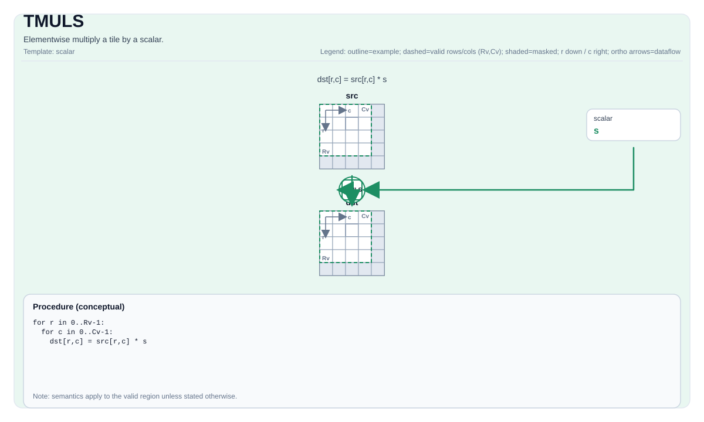

# TMULS


## Tile Operation Diagram



## Introduction

Elementwise multiply a tile by a scalar.

## Math Interpretation

For each element `(i, j)` in the valid region:

$$ \mathrm{dst}_{i,j} = \mathrm{src}_{i,j} \cdot \mathrm{scalar} $$

## C++ Intrinsic

Declared in `include/pto/common/pto_instr.hpp`:

```cpp
template <typename TileDataDst, typename TileDataSrc, typename... WaitEvents>
PTO_INST RecordEvent TMULS(TileDataDst &dst, TileDataSrc &src0, typename TileDataSrc::DType scalar, WaitEvents &... events);
```

## Constraints

- **Implementation checks (A2A3)**:
    - `TileData::DType` must be one of: `int32_t`, `int16_t`, `half`, `float`.
    - Tile location must be vector (`TileData::Loc == TileType::Vec`).
    - Static valid bounds: `TileData::ValidRow <= TileData::Rows` and `TileData::ValidCol <= TileData::Cols`.
    - Runtime: `src0.GetValidRow() == dst.GetValidRow()` and `src0.GetValidCol() == dst.GetValidCol()`.
    - Tile layout must be row-major (`TileData::isRowMajor`).
- **Implementation checks (A5)**:
    - `TileData::DType` must be one of: `uint16_t`, `int16_t`, `uint32_t`, `int32_t`, `int64_t`, `uint64_t`, `half`, `float`, `bfloat16_t`.
    - Tile location must be vector (`TileData::Loc == TileType::Vec`).
    - Static valid bounds: `TileData::ValidRow <= TileData::Rows` and `TileData::ValidCol <= TileData::Cols`.
    - Runtime: `src0.GetValidCol() == dst.GetValidCol()`.
    - Tile layout must be row-major (`TileData::isRowMajor`).
- **Valid region**:
    - The op uses `dst.GetValidRow()` / `dst.GetValidCol()` as the iteration domain.

## Examples

### Auto

```cpp
#include <pto/pto-inst.hpp>

using namespace pto;

void example_auto() {
  using TileT = Tile<TileType::Vec, float, 16, 16>;
  TileT src, dst;
  TMULS(dst, src, 2.0f);
}
```

### Manual

```cpp
#include <pto/pto-inst.hpp>

using namespace pto;

void example_manual() {
  using TileT = Tile<TileType::Vec, float, 16, 16>;
  TileT src, dst;
  TASSIGN(src, 0x1000);
  TASSIGN(dst, 0x2000);
  TMULS(dst, src, 2.0f);
}
```

## Ascend310P / A1 profile

A1 supports matching FP16/FP32 source and destination Vec tiles with static full row-major shapes, no layout padding, and 32-byte-aligned rows. The scalar has the source element type. Storage must be disjoint or an exact alias; shifted overlap traps before execution. The native `vmuls` path masks the final incomplete 256-byte repeat and splits larger work into at most 255 repeats per instruction. Integer/BF16, packed-column and dynamic-valid tiles are outside this A1 profile. Device execution remains a separate validation step.
