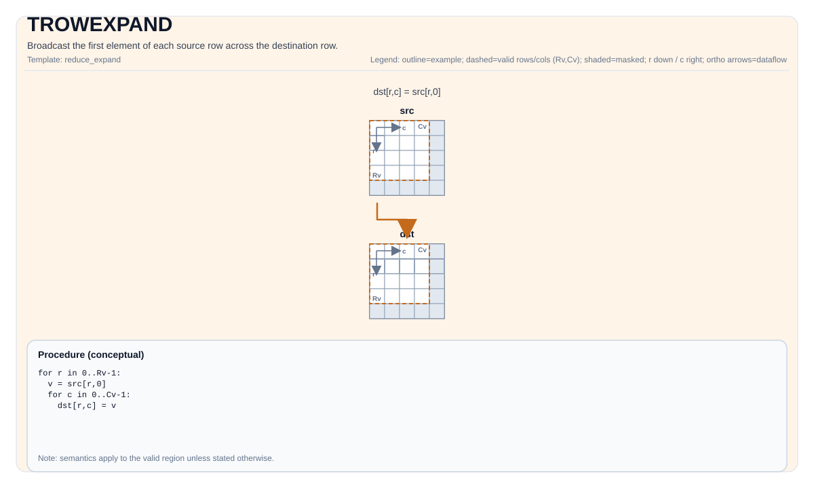

# TROWEXPAND


## Tile Operation Diagram



## Introduction

Broadcast the first element of each source row across the destination row.

## Math Interpretation

Let `R = dst.GetValidRow()` and `C = dst.GetValidCol()`. For `0 <= i < R` and `0 <= j < C`:

$$ \mathrm{dst}_{i,j} = \mathrm{src}_{i,0} $$

## C++ Intrinsic

Declared in `include/pto/common/pto_instr.hpp`:

```cpp
template <typename TileDataDst, typename TileDataSrc, typename... WaitEvents>
PTO_INST RecordEvent TROWEXPAND(TileDataDst &dst, TileDataSrc &src, WaitEvents &... events);
```

## Constraints

Implementation checks (NPU):

- Tile Type: `dst` and `src` must be `TileType::Vec`.
- Tile layout: non-fractal RowMajor `dst`; non-fractal RowMajor or ColMajor `src` (`SLayout::NoneBox`). Input and output element types must match.
- A5 requires source static `ValidCol` to be 1 or dynamic (-1); use valid column count 1 for scalar row broadcast.
- Data type (A2A3): element types must be one of: `int8_t` or `uint8_t` or `int16_t` or `uint16_t` or `int32_t` or `uint32_t` or `half` or `bfloat16_t` or `float`.
- Data type (A5): element types must be one of: `int8_t` or `uint8_t` or `int16_t` or `uint16_t` or `int32_t` or `uint32_t` or `int64_t` or `uint64_t` or `half` or `bfloat16_t` or `float`.
- Runtime valid checks:
    - A2A3: returns early if any of `dstValidRow`, `dstValidCol`, `srcValidRow`, `srcValidCol` is zero.
    - A5: asserts `srcValidRow == dstValidRow` and asserts `srcValidRow != 0 && srcValidCol != 0`.

- 64-bit input (A5): an ND source may use physical `[64,4]`, valid `[64,1]`; a DN source may use compact `[64,1]`. Each row broadcasts `src[i,0]` using the physical `RowStride`.
- Unlike binary row-broadcast instructions such as [TROWEXPANDADD](TROWEXPANDADD.md), this instruction uses one scalar per row for ND sources as well, without repeating a 32-byte block.

## Ascend 310P (A1)

A1 accepts matching FP16/FP32 Vec tiles with a full static packed column-major
`M x 1` source and row-major `M x N` destination. Rows and storage obey the A1
32-byte alignment and UB-budget checks; source and destination must be disjoint.

For N >= 16 and row stride at most 255 blocks of 32 bytes, native b16/b32
transposition replicates packed input values into the first output blocks.
Bitwise OR copies those blocks across each remaining row. This path does not
read UB values through the scalar pipeline or reserve temporary UB storage;
it preserves all input bits, including signed zeros and NaN payloads.
Transpose repeats use zero strides for a single repeat; copy repeat counts and
masks are bounded, including partial final rows of repeats and column tails.
Narrower FP32 rows and larger strides retain the existing scalar implementation.
The caller remains responsible for producer/consumer pipeline synchronization.

`tests/compile/test_a1_row_broadcast_bits_native.py` runs a CPU oracle before
the device and checks exact output/input bits, adjacent UB/GM guards, all 65,536
FP16 patterns, FP32 special/random patterns, and stride/repeat boundaries.

## Examples

### Auto

```cpp
#include <pto/pto-inst.hpp>

using namespace pto;

void example_auto() {
  using SrcT = Tile<TileType::Vec, float, 16, 8, BLayout::RowMajor, 16, 1>;
  using DstT = Tile<TileType::Vec, float, 16, 16>;
  SrcT src;
  DstT dst;
  TROWEXPAND(dst, src);
}
```

### Manual

```cpp
#include <pto/pto-inst.hpp>

using namespace pto;

void example_manual() {
  using SrcT = Tile<TileType::Vec, float, 16, 8, BLayout::RowMajor, 16, 1>;
  using DstT = Tile<TileType::Vec, float, 16, 16>;
  SrcT src;
  DstT dst;
  TASSIGN(src, 0x1000);
  TASSIGN(dst, 0x2000);
  TROWEXPAND(dst, src);
}
```
