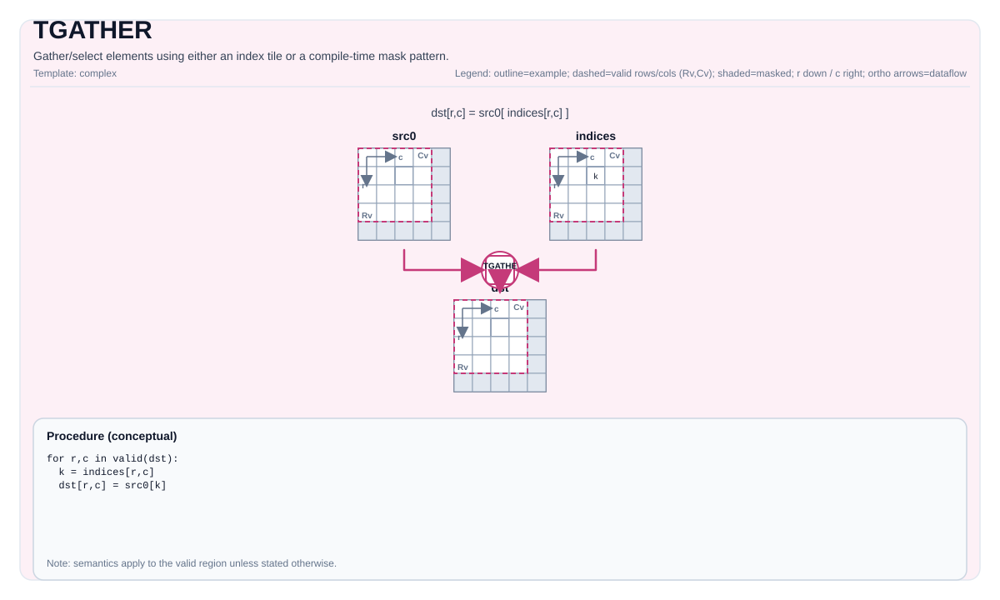

# TGATHER

## 指令示意图



## 简介

使用索引 Tile 或编译时掩码模式来收集/选择元素。

## 数学语义

基于索引的 gather（概念性定义）：

设 `R = dst.GetValidRow()`，`C = dst.GetValidCol()`。对于 `0 <= i < R` 且 `0 <= j < C`：

$$ \mathrm{dst}_{i,j} = \mathrm{src0}\!\left[\mathrm{indices}_{i,j}\right] $$

确切的索引解释和边界行为由实现定义。

基于掩码模式的 gather 是由 `pto::MaskPattern` 控制的实现定义的选择/归约操作。

## 汇编语法

PTO-AS 形式：参见 [汇编写法与操作数](../../../syntax-and-operands/assembly-model_zh.md)。

基于索引的 gather：

```text
%dst = tgather %src0, %indices : !pto.tile<...> -> !pto.tile<...>
```

基于掩码模式的 gather：

```text
%dst = tgather %src {maskPattern = #pto.mask_pattern<P0101>} : !pto.tile<...> -> !pto.tile<...>
```

### AS Level 1（SSA）

```text
%dst = pto.tgather %src, %indices : (!pto.tile<...>, !pto.tile<...>) -> !pto.tile<...>
%dst = pto.tgather %src {maskPattern = #pto.mask_pattern<P0101>}: !pto.tile<...> -> !pto.tile<...>
```

### AS Level 2（DPS）

```text
pto.tgather ins(%src, %indices : !pto.tile_buf<...>, !pto.tile_buf<...>) outs(%dst : !pto.tile_buf<...>)
pto.tgather ins(%src, {maskPattern = #pto.mask_pattern<P0101>} : !pto.tile_buf<...>) outs(%dst : !pto.tile_buf<...>)
```

## C++ 内建接口

声明于 `include/pto/common/pto_instr.hpp`：

### 基于索引的 Gather

```cpp
template <typename TileDataD, typename TileDataS0, typename TileDataS1, typename TileDataTmp, typename... WaitEvents>
PTO_INST RecordEvent TGATHER(TileDataD &dst, TileDataS0 &src0, TileDataS1 &src1, TileDataTmp &tmp, WaitEvents &... events);
```

### 基于掩码模式的 Gather

```cpp
template <typename DstTileData, typename SrcTileData, MaskPattern maskPattern, typename... WaitEvents>
PTO_INST RecordEvent TGATHER(DstTileData &dst, SrcTileData &src, WaitEvents &... events);
```

### 基于比较的 Gather（TGather_cmp）

收集满足与每行阈值标量比较条件的元素的索引。

```cpp
template <typename TileDataD, typename TileDataS, typename TileDataS1, typename TileDataC, typename TileDataTmp, CmpMode cmpMode, typename... WaitEvents>
PTO_INST RecordEvent TGATHER(TileDataD &dst, TileDataS &src0, TileDataS1 &k_value, TileDataC &cdst, TileDataTmp &tmp, uint32_t offset, WaitEvents &... events);
```

对于 `src0` 的每一行 `i`，使用 `cmpMode`（GT 或 EQ）将每个元素 `src0[i, j]` 与阈值 `k_value[i]` 比较。匹配元素的索引被收集到 `dst[i]` 中。每行的匹配数量存储在 `cdst[i]` 中。`offset` 参数指定起始索引值。

#### 基于比较的 Gather 约束

- **A2A3**:
    - `TileDataD::DType` 必须是 `int32_t` 或 `uint32_t`。
    - `TileDataS::DType` 必须是 `float`、`half`，或 `int32_t`（仅 EQ 模式）。
    - `TileDataS1::DType` 必须是 `int32_t` 或 `uint32_t`。
    - `cmpMode` 必须是 `CmpMode::GT` 或 `CmpMode::EQ`。
- **A5**:
    - `TileDataD::DType` 必须是 `int32_t` 或 `uint32_t`。
    - `TileDataS::DType` 必须是 `int16_t`、`uint16_t`、`int32_t`、`uint32_t`、`half` 或 `float`。
    - `TileDataS1::DType` 必须是 `uint16_t` 或 `uint32_t`。
    - `cmpMode` 必须是 `CmpMode::GT` 或 `CmpMode::EQ`。

### Ascend310P（A1）索引 gather

A1 的手动模式支持既有四 Tile 索引形式。源与目标类型必须相同，支持 FP16、
FP32、INT32 和 UINT32。四个 Tile 必须均为完整静态、连续行主序 Vec，行按
32 字节对齐、无 padding，且每个 Tile 均在配置的 UB 容量内。目标与索引形状
必须相同；源 Tile 的行列形状可以不同。

索引与 scratch 必须使用相同的 INT32 或 UINT32 类型。索引仍为展平的**元素**
偏移，可跨越源行。scratch 容量约定保持不变：至少需要
`dst.Numel * sizeof(src element) / 2` 个 32 位元素。实现仅写入前
`dst.Numel` 项：用整数向量加法生成字节偏移，再用原生 16/32 位 `vgather`
逐位复制，不做数值转换，无隐藏 UB 分配。A1 尚未实现掩码模式和比较形式。

目标与 scratch 彼此不得重叠，也不得与任一只读输入重叠；实现会在写入前 trap。
两个只读输入可以别名。索引范围仍由调用方保证。调用方须让 DMA 索引和值对
V 可见。入口保留 S 到 V 握手，兼容既有标量生产者。向量屏障依次保证先前
生产者、偏移生成和 gather 的执行顺序；最后以
保留的本地事件 ID 7 完成 V 到 S 握手，才将 scratch 交回标量使用者。两组握手
均使用事件 ID 7，并在返回前排空；原先开头的 V 到 S 握手不再需要。返回时
向量掩码恢复为 normal/full；调用方仍须同步输出消费者。

旧路径对每个 16/32 位输出元素生成一/两个标量偏移，新路径对每组 64 个索引
执行一/两条向量加法。这仅比较指令数量，不是设备加速实测。CPU 模型与离线
CCEC 检查不能证明设备时延或异步时序正确性。

这些是后端限制，不改变虚拟 ISA 或公共 C++ 签名。CPU、原生指令模型和离线
CCEC 检查位于 `tests/compile/test_a1_indexed_gather_host.py`，不代表设备正确性
或性能已经验证。


## 约束

!!! warning "约束"
    - **基于索引的 gather：实现检查 (A2A3)**:
        - `sizeof(DstTileData::DType)` 必须是 2 或 4 字节（b16/b32）。
        - `sizeof(Src1TileData::DType)` 必须是 4 字节（b32: `int32_t`、`uint32_t`）。
        - `DstTileData::DType` 必须与 `Src0TileData::DType` 类型相同。
        - `TmpTileData::DType` 必须与 `Src1TileData::DType` 类型相同。
        - `src1.GetValidCol() == TmpTileData::Cols` 且 `src1.GetValidRow() == TmpTileData::Rows`。
        - `dst.GetValidCol() == DstTileData::Cols`（连续的目标存储）。
    - **基于索引的 gather：实现检查 (A5)**:
        - `sizeof(DstTileData::DType)` 对应类型必须是 `int16_t`、`uint16_t`、`int32_t`、`uint32_t`、`half`、`float` 之一。
        - `sizeof(Src1TileData::DType)` 对应类型必须是 `int16_t`、`uint16_t`、`int32_t`、`uint32_t` 之一。
        - `DstTileData::DType` 必须与 `Src0TileData::DType` 类型相同。
        - `src1.GetValidCol() == Src1TileData::Cols` 且 `dst.GetValidCol() == DstTileData::Cols`。
    - **基于掩码模式的 gather：实现检查 (A2A3)**:
        - 源元素大小必须是 `2` 或 `4` 字节。
        - `SrcTileData::DType`/`DstTileData::DType` 必须是 `int16_t`、`uint16_t`、`int32_t`、`uint32_t`、`half`、`bfloat16_t` 或 `float` 之一。
        - `dst` 和 `src` 必须都是 `TileType::Vec` 且行主序。
        - `sizeof(dst element) == sizeof(src element)` 且 `dst.GetValidCol() == DstTileData::Cols`（连续的目标存储）。
    - **基于掩码模式的 gather：实现检查 (A5)**:
        - 源元素大小必须是 `1`、`2` 或 `4` 字节。
        - `dst` 和 `src` 必须都是 `TileType::Vec` 且行主序。
        - `SrcTileData::DType`/`DstTileData::DType` 必须是 `int8_t`、`uint8_t`、`int16_t`、`uint16_t`、`int32_t`、`uint32_t`、`half`、`bfloat16_t`、`float`、`float8_e4m3_t`、`float8_e5m2_t` 或 `hifloat8_t` 之一。
        - 支持的数据类型限制为目标定义的集合（通过实现中的 `static_assert` 强制执行），且 `sizeof(dst element) == sizeof(src element)`，`dst.GetValidCol() == DstTileData::Cols`（连续的目标存储）。
    - **边界 / 有效性**:
        - 索引边界不通过显式运行时断言进行验证；超出范围的索引行为由目标定义。
    - **临时 Tile**:
        - **基于索引的 Gather (A2/A3)**：C++ API 需要显式传入 `tmp` Tile。`TileDataTmp::DType` 必须与 `TileDataS1::DType` 类型相同（`int32_t` 或 `uint32_t`）。`src1.GetValidRow() == TileDataTmp::Rows` 且 `src1.GetValidCol() == TileDataTmp::Cols`。tmp Tile 用于存放 b16 源类型的 `vmuls` 中间结果供 `vgather` 使用；对于 b32 源类型，结果直接写入 `dst`，但 API 仍需要 `tmp`。
        - **基于索引的 Gather (A5)**：`tmp` Tile 被接受但不使用。A5 硬件无需临时缓冲区即可处理基于索引的 Gather。
        - **基于比较的 Gather (A2/A3)**：C++ API 需要显式传入 `tmp` Tile，该 Tile 作为三个内部区域的合并暂存缓冲区：
            1. **cmpsTmp**（比较结果位图）：偏移量 0，以 `uint8_t` 存储，大小 = `TileDataTmp::Rows × TileDataTmp::Cols` 字节。
            2. **indexTmp**（索引数组）：偏移量 = `TileDataTmp::Rows × TileDataTmp::Cols × sizeof(uint8_t)`，以 `TileDataD::DType` 存储，大小 = `TileDataS::Rows × TileDataS::Cols × sizeof(TileDataD::DType)` 字节。
            3. **cvtTmp**（转换后的 k 值数组）：偏移量 = `TileDataTmp::Rows × TileDataTmp::Cols × sizeof(uint8_t)` + `TileDataS::Rows × TileDataS::Cols × sizeof(TileDataD::DType)`，以 `TileDataS::DType` 存储，大小 = `TileDataS::Rows × sizeof(TileDataS::DType)` 字节。
            最小 tmp 大小（字节）必须满足：
            $$ \text{tmpSize} \ge \text{Rows}_\text{tmp} \times \text{Cols}_\text{tmp} + \text{Rows}_\text{src} \times \text{Cols}_\text{src} \times \text{sizeof(DType}_\text{dst}\text{)} + \text{Rows}_\text{src} \times \text{sizeof(DType}_\text{src}\text{)} $$
        - **基于比较的 Gather (A5)**：`tmp` Tile 被接受但不使用。A5 硬件无需临时缓冲区即可处理基于比较的 Gather。

## 示例

### 自动（Auto）

```cpp
#include <pto/pto-inst.hpp>

using namespace pto;

void example_auto() {
  using SrcT = Tile<TileType::Vec, float, 16, 16>;
  using IdxT = Tile<TileType::Vec, int32_t, 16, 16>;
  using DstT = Tile<TileType::Vec, float, 16, 16>;
  SrcT src0;
  IdxT idx;
  DstT dst;
  TGATHER(dst, src0, idx);
}
```

### 手动（Manual）

```cpp
#include <pto/pto-inst.hpp>

using namespace pto;

void example_manual() {
  using SrcT = Tile<TileType::Vec, float, 16, 16>;
  using DstT = Tile<TileType::Vec, float, 1, 16>;
  SrcT src;
  DstT dst;
  TASSIGN(src, 0x1000);
  TASSIGN(dst, 0x2000);
  TGATHER<DstT, SrcT, MaskPattern::P0101>(dst, src);
}
```

## 汇编示例（ASM）

### 自动模式

```text
# 自动模式：由编译器/运行时负责资源放置与调度。
%dst = pto.tgather %src, %indices : (!pto.tile<...>, !pto.tile<...>) -> !pto.tile<...>
```

### 手动模式

```text
# 手动模式：先显式绑定资源，再发射指令。
# 可选（当该指令包含 tile 操作数时）：
# pto.tassign %arg0, @tile(0x1000)
# pto.tassign %arg1, @tile(0x2000)
%dst = pto.tgather %src, %indices : (!pto.tile<...>, !pto.tile<...>) -> !pto.tile<...>
```

### PTO 汇编形式

```text
%dst = pto.tgather %src, %indices : (!pto.tile<...>, !pto.tile<...>) -> !pto.tile<...>
# AS Level 2 (DPS)
pto.tgather ins(%src, %indices : !pto.tile_buf<...>, !pto.tile_buf<...>) outs(%dst : !pto.tile_buf<...>)
```
