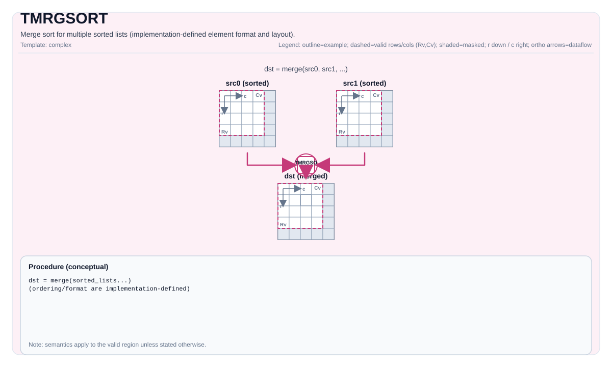

# TMRGSORT

## 指令示意图



## 简介

硬件加速的多路归并排序（`vmrgsort4`）。将最多 4 个已预排序的列表归并为一个**降序**排列的输出。每个元素是固定 8 字节的**值-索引对**结构体。

## Ascend310P（A1）支持范围

A1 复用既有的显式 scratch **2～4 列表**接口。后面的通用章节还描述其他后端，
A1 的具体限制如下：

- 所有操作数均为单行、完整静态、连续行主序 FP32 Vec。每个源包含正整数倍的
  **16 对**（32 个 FP32 元素），并已按分数降序排列。目的容量为正的 32 字节对齐
  前缀，不超过全部输入 pair 的总数。
- `GETMRGSORTTMPSIZE<Src0, Src1, ...>()` 返回 FP32 元素容量：
  **8 × 各源 Numel 之和**，即 **16 × 输入 pair 总数**。调用方提供两组八字段
  proposal bank；scratch 和各操作数均须符合 A1 UB 预算。拒绝可写重叠，允许只读
  源列表别名，不分配隐藏 UB。
- 分数相等时先取较早的源列表，同一源内部保持原顺序。索引按 UINT32 原始位复制，
  不作数值转换或额外的索引大小排序；保留符号零等分数位型。NaN 分数顺序未定义。
- A1 先完成完整原生 proposal 归并，再修复稳定平局并施加目的容量边界。
  `exhausted=true` 在任一逻辑源耗尽时停止复制，未写输出后缀保持原值。
  `executedNumList` 返回各列表实际复制的 pair 数，未使用项为零。该 A1 计数由
  压紧过程计算，**不是**读取 `VMS4_SR`；`exhausted=false` 也定义这些计数。
- 打包采用带 mask 的 32 位向量 gather 和整数来源标记。第二组 proposal bank 先
  复用为偏移表，打包完成后才被原生归并覆盖。标量压紧由预留 event 7 同步，返回前
  排空事件并恢复 normal/full mask。
- A1 尚不支持单列表/blockLen 形式、FP16、部分有效形状或源尾块。CPU/离线检查
  不证明设备精度、时序、重叠或性能；完整归并搬运和标量压紧仍须实测后才能切换模型默认
  路径，proposal 驻留融合链可用于后续减少格式转换。

既有公共接口示例（scratch 查询结果随目标后端变化）：

```cpp
#include <cstdint>
#include <pto/pto-inst.hpp>
using Input = pto::Tile<pto::TileType::Vec, float, 1, 64>;
using Output = pto::Tile<pto::TileType::Vec, float, 1, 128>;
using Scratch = pto::Tile<pto::TileType::Vec, float, 1, pto::GETMRGSORTTMPSIZE<Input, Input>()>;
AICORE void MergeExample(Output& dst, Input& src0, Input& src1, Scratch& tmp) {
    pto::MrgSortExecutedNumList consumed{};
    pto::TMRGSORT<Output, Scratch, Input, Input, false>(dst, consumed, tmp, src0, src1);
}
```

## 数据格式：值-索引对

TMRGSORT 操作的是 8 字节结构体，Tile 中的每个元素构成值-索引对的一部分：

| 数据类型 | 值字段 | 填充 | 索引字段 | 结构体大小 | 每结构体占 Tile 元素数 |
|----------|--------|------|----------|------------|----------------------|
| `float`  | 4 字节 | 0    | 4 字节（`uint32_t`） | 8 字节 | **2 个元素** |
| `half`   | 2 字节 | 2 字节 | 4 字节（`uint32_t`） | 8 字节 | **4 个元素** |

因此 Tile 中排序对的数量为：

- `float`：`numPairs = ValidCol / 2`
- `half`：`numPairs = ValidCol / 4`

实现通过 `ELE_NUM_SHIFT` 将 `ValidCol` 转换为对数：

```cpp
// float: ELE_NUM_SHIFT = 1  →  numPairs = ValidCol >> 1
// half:  ELE_NUM_SHIFT = 2  →  numPairs = ValidCol >> 2
```

## 数学语义

将已预排序的输入列表按降序归并到 `dst` 中：

$$ \mathrm{dst} = \mathrm{merge\_desc}(\mathrm{src}_0, \mathrm{src}_1, \ldots) $$

## 两种变体

### 变体 A：单列表排序 — `TMRGSORT(dst, src, blockLen)`

将 `src` 视为 **4 个连续等长的已排序块**，在单个 Tile 内完成 4 路归并。

```
src Tile（1 行）：
┌── blockLen ──┬── blockLen ──┬── blockLen ──┬── blockLen ──┐
│    块 0      │    块 1      │    块 2      │    块 3      │
│ （已预排序）  │ （已预排序）  │ （已预排序）  │ （已预排序）  │
└──────────────┴──────────────┴──────────────┴──────────────┘
                        ↓ vmrgsort4
dst Tile（1 行）：
┌──────────── 归并结果（降序）────────────┐
└─────────────────────────────────────────┘
```

**约束：**

- `blockLen` 必须是 **64** 的倍数。
- `src.GetValidCol()` 必须是 `blockLen * 4` 的整数倍。
- `repeatTimes = src.GetValidCol() / (blockLen * 4)` 必须在 `[1, 255]` 范围内。
- **不需要 `tmp`** — 结果直接写入 `dst`。
- 无 `exhausted` 参数（固定为非挂起模式）。

**`blockLen` 对应的排序对数：**

| blockLen | float 每块对数 | half 每块对数 |
|----------|---------------|--------------|
| 64       | 32            | 16           |
| 128      | 64            | 32           |
| 256      | 128           | 64           |

### 变体 B：多列表归并 — `TMRGSORT<..., exhausted>(dst, executedNumList, tmp, src0, src1, [src2], [src3])`

将 2~4 个**独立的已预排序列表**归并为一个有序输出。

```
src0 Tile ──┐
src1 Tile ──┤
src2 Tile ──┼──→ vmrgsort4 ──→ tmp ──→ dst
src3 Tile ──┘
```

**模板参数 `exhausted`：**

- `exhausted = false`：正常归并 — 处理所有输入数据。
- `exhausted = true`：当任一输入列表耗尽时，硬件挂起并通过 `executedNumList` 返回每个列表实际处理的元素数量。

**`MrgSortExecutedNumList` 结构体：**

```cpp
struct MrgSortExecutedNumList {
    uint16_t mrgSortList0;  // 列表 0 已处理的元素数
    uint16_t mrgSortList1;  // 列表 1 已处理的元素数
    uint16_t mrgSortList2;  // 列表 2 已处理的元素数
    uint16_t mrgSortList3;  // 列表 3 已处理的元素数
};
```

仅在 `exhausted = true` 时有意义。数据来自硬件寄存器 `VMS4_SR`。

**不同列表数的 mask 配置：**

| 列表数 | Xt[11:8] mask | 未使用的列表 |
|--------|---------------|-------------|
| 2 列表 | `0b0011`      | src2, src3（size=0） |
| 3 列表 | `0b0111`      | src3（size=0） |
| 4 列表 | `0b1111`      | 无 |

## 汇编语法

同步形式（概念性）：

```text
%dst, %executed = tmrgsort %src0, %src1 {exhausted = false}
    : !pto.tile<...>, !pto.tile<...> -> (!pto.tile<...>, vector<4xi16>)
```

### AS Level 1（SSA）

```text
%dst = pto.tmrgsort %src, %blockLen : (!pto.tile<...>, dtype) -> !pto.tile<...>
%dst, %executed = pto.tmrgsort %src0, %src1, %src2, %src3 {exhausted = false}
 : (!pto.tile<...>, !pto.tile<...>, !pto.tile<...>, !pto.tile<...>) -> (!pto.tile<...>, vector<4xi16>)
```

### AS Level 2（DPS）

```text
pto.tmrgsort ins(%src, %blockLen : !pto.tile_buf<...>, dtype)  outs(%dst : !pto.tile_buf<...>)
pto.tmrgsort ins(%src0, %src1, %src2, %src3 {exhausted = false} : !pto.tile_buf<...>, !pto.tile_buf<...>, !pto.tile_buf<...>, !pto.tile_buf<...>)
outs(%dst, %executed : !pto.tile_buf<...>, vector<4xi16>)
```

## C++ 内建接口

声明于 `include/pto/common/pto_instr.hpp`：

### 单列表变体

```cpp
template <typename DstTileData, typename SrcTileData, typename... WaitEvents>
PTO_INST RecordEvent TMRGSORT(DstTileData &dst, SrcTileData &src, uint32_t blockLen, WaitEvents &... events);
```

### 多列表变体（2/3/4 列表）

```cpp
// 4 列表
template <typename DstTileData, typename TmpTileData, typename Src0TileData, typename Src1TileData,
          typename Src2TileData, typename Src3TileData, bool exhausted, typename... WaitEvents>
PTO_INST RecordEvent TMRGSORT(DstTileData &dst, MrgSortExecutedNumList &executedNumList, TmpTileData &tmp,
                              Src0TileData &src0, Src1TileData &src1, Src2TileData &src2, Src3TileData &src3,
                              WaitEvents &... events);

// 3 列表
template <typename DstTileData, typename TmpTileData, typename Src0TileData, typename Src1TileData,
          typename Src2TileData, bool exhausted, typename... WaitEvents>
PTO_INST RecordEvent TMRGSORT(DstTileData &dst, MrgSortExecutedNumList &executedNumList, TmpTileData &tmp,
                              Src0TileData &src0, Src1TileData &src1, Src2TileData &src2,
                              WaitEvents &... events);

// 2 列表
template <typename DstTileData, typename TmpTileData, typename Src0TileData, typename Src1TileData,
          bool exhausted, typename... WaitEvents>
PTO_INST RecordEvent TMRGSORT(DstTileData &dst, MrgSortExecutedNumList &executedNumList, TmpTileData &tmp,
                              Src0TileData &src0, Src1TileData &src1, WaitEvents &... events);
```

## 约束

### 通用约束（A2A3 和 A5）

| 约束项 | 要求 |
|--------|------|
| Tile 类型 | 所有 Tile 必须是 `TileType::Vec` |
| 行数 | 所有 Tile 必须 `Rows == 1` |
| 布局 | 所有 Tile 必须是行主序（`BLayout::RowMajor`） |
| 数据类型 | `half` 或 `float`，且所有 Tile 一致 |
| UB 内存 | 总计不超过 192 KiB（`UB_SIZE`） |

### 各变体的 UB 内存约束

| 变体 | 约束 |
|------|------|
| 单列表 | `(src.Cols + dst.Cols) * sizeof(T) < UB_SIZE` |
| 2 列表 | `(src0.Cols + src1.Cols + tmp.Cols) * sizeof(T) < UB_SIZE`，且 `tmp.Cols + src0.Cols <= UB_SIZE / sizeof(T)` |
| 3 列表 | `(src0.Cols + src1.Cols + src2.Cols + tmp.Cols) * sizeof(T) < UB_SIZE` |
| 4 列表 | `(src0.Cols + src1.Cols + src2.Cols + src3.Cols + tmp.Cols) * sizeof(T) < UB_SIZE` |

### 单列表约束

- `blockLen` 必须是 64 的倍数。
- `src.GetValidCol()` 必须是 `blockLen * 4` 的整数倍。
- `repeatTimes = src.GetValidCol() / (blockLen * 4)` 必须在 `[1, 255]` 范围内。

## 临时空间

### 多列表变体（2/3/4 列表）

`tmp` **被使用**作为 `vmrgsort4` 硬件指令的中间输出缓冲区。归并排序结果首先写入 `tmp`，然后通过 `MovUb2Ub`（UB 到 UB 的 memcpy）复制到 `dst`。

- `tmp` 必须与 `dst` 和所有 `src` Tile 具有相同的元素类型（`half` 或 `float`）。
- `tmp` 必须 `Rows == 1` 且为行主序。
- `tmp` 的 Cols 必须至少为所有输入源 Cols 之和：
    - 2 列表：`tmp.Cols >= src0.Cols + src1.Cols`
    - 3 列表：`tmp.Cols >= src0.Cols + src1.Cols + src2.Cols`
    - 4 列表：`tmp.Cols >= src0.Cols + src1.Cols + src2.Cols + src3.Cols`
- 辅助函数 `GETMRGSORTTMPSIZE<...>()` 返回所需的 `tmp` Cols：

```cpp
// 2 列表
GETMRGSORTTMPSIZE<Src0Tile, Src1Tile>() = Src0Tile::Cols + Src1Tile::Cols

// 3 列表
GETMRGSORTTMPSIZE<Src0Tile, Src1Tile, Src2Tile>() = Src0Tile::Cols + Src1Tile::Cols + Src2Tile::Cols

// 4 列表
GETMRGSORTTMPSIZE<Src0Tile, Src1Tile, Src2Tile, Src3Tile>() = Src0Tile::Cols + Src1Tile::Cols + Src2Tile::Cols + Src3Tile::Cols
```

### 单列表变体

**不需要** `tmp`。单列表变体直接写入 `dst`。

## 典型用法：TopK

TMRGSORT 常用于通过迭代归并排序实现 TopK 选择：

```
阶段 1：单列表排序（逐步增大 blockLen）
  blockLen=64:  每 256 个元素 → 4 路归并 → 256 个有序元素
  blockLen=256: 每 1024 个元素 → 4 路归并 → 1024 个有序元素
  ... 直到 blockLen * 4 > totalCols

阶段 2：尾部归并（SortTailBlock）
  使用 2 列表变体归并剩余块，保留前 K 个元素
```

## A2A3 与 A5 的差异

两者实现几乎完全相同，均调用 `vmrgsort4` 硬件指令。微小差异：

| 项目 | A2A3 | A5 |
|------|------|-----|
| `UB_SIZE` 常量 | 硬编码 `196608`（192×1024） | 使用 `PTO_UBUF_SIZE_BYTES` |
| `TMRGSORT_BLOCK_LEN` | 定义了常量 `64` | 未定义（直接使用字面量） |
| 核心逻辑 | 相同 | 相同 |

## 示例

### 单列表排序（自动模式）

```cpp
#include <pto/pto-inst.hpp>

using namespace pto;

void example_single() {
  using SrcT = Tile<TileType::Vec, float, 1, 256>;
  using DstT = Tile<TileType::Vec, float, 1, 256>;
  SrcT src;
  DstT dst;
  TMRGSORT(dst, src, /*blockLen=*/64);
}
```

### 多列表归并（4 列表，非挂起模式）

```cpp
#include <pto/pto-inst.hpp>

using namespace pto;

void example_multi4() {
  using SrcT = Tile<TileType::Vec, float, 1, 128>;
  using DstT = Tile<TileType::Vec, float, 1, 512>;
  using TmpT = Tile<TileType::Vec, float, 1, 512>;
  SrcT src0, src1, src2, src3;
  DstT dst;
  TmpT tmp;
  MrgSortExecutedNumList executedNumList;
  TMRGSORT<DstT, TmpT, SrcT, SrcT, SrcT, SrcT, /*exhausted=*/false>(
      dst, executedNumList, tmp, src0, src1, src2, src3);
}
```

### 多列表归并（2 列表，挂起模式）

```cpp
#include <pto/pto-inst.hpp>

using namespace pto;

void example_exhausted() {
  using SrcT = Tile<TileType::Vec, float, 1, 64>;
  using DstT = Tile<TileType::Vec, float, 1, 128>;
  using TmpT = Tile<TileType::Vec, float, 1, 128>;
  SrcT src0, src1;
  DstT dst;
  TmpT tmp;
  MrgSortExecutedNumList executedNumList;
  TMRGSORT<DstT, TmpT, SrcT, SrcT, /*exhausted=*/true>(
      dst, executedNumList, tmp, src0, src1);
  // 执行后：
  // executedNumList.mrgSortList0 = src0 已处理的元素数
  // executedNumList.mrgSortList1 = src1 已处理的元素数
}
```

### 手动模式（单列表）

```cpp
#include <pto/pto-inst.hpp>

using namespace pto;

void example_manual() {
  using SrcT = Tile<TileType::Vec, float, 1, 256>;
  using DstT = Tile<TileType::Vec, float, 1, 256>;
  SrcT src;
  DstT dst;
  TASSIGN(src, 0x1000);
  TASSIGN(dst, 0x2000);
  TMRGSORT(dst, src, /*blockLen=*/64);
}
```

## 汇编示例（ASM）

### 自动模式

```text
# 自动模式：由编译器/运行时负责资源放置与调度。
%dst = pto.tmrgsort %src, %blockLen : (!pto.tile<...>, dtype) -> !pto.tile<...>
```

### 手动模式

```text
# 手动模式：先显式绑定资源，再发射指令。
# 可选（当该指令包含 tile 操作数时）：
# pto.tassign %arg0, @tile(0x1000)
# pto.tassign %arg1, @tile(0x2000)
%dst = pto.tmrgsort %src, %blockLen : (!pto.tile<...>, dtype) -> !pto.tile<...>
```

### PTO 汇编形式

```text
%dst = pto.tmrgsort %src, %blockLen : (!pto.tile<...>, dtype) -> !pto.tile<...>
# AS Level 2 (DPS)
pto.tmrgsort ins(%src, %blockLen : !pto.tile_buf<...>, dtype)  outs(%dst : !pto.tile_buf<...>)
```
